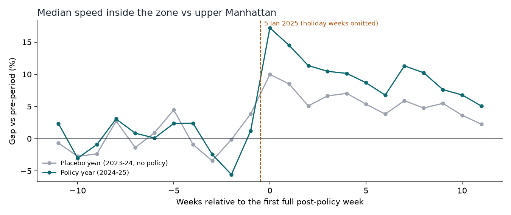

# Congestion Pricing Impact

On 5 January 2025, New York began charging vehicles that enter Manhattan below 60th Street. Did yellow-taxi trips inside that zone get faster, and did fewer of them happen? This is a difference-in-differences study on **42.1 million real TLC trip records**. The same comparison is repeated on the year before, when there was no policy, as a placebo.

> **Status: learning project (September 2026).** It is built, tested, and run on real data, but I am still practising explaining it. The results are about **yellow taxis only**, measured with trip records rather than traffic sensors. They are estimates under stated assumptions, not a verdict on the policy.



## Answer

| Outcome | Estimate (policy year minus placebo year) | 95% interval | Holds up under robustness checks? |
|---|---:|---:|---|
| **Median speed** of trips inside the zone, relative to trips inside upper Manhattan | **+3.8%** | [+0.8%, +7.0%] | Yes. It stays at +3.8% to +4.2% across all four variants |
| **Number of trips** touching the zone, relative to trips that don't | −6.3% | [−11.2%, −1.4%] | **No.** Dropping `payment_type 0` rows flips it to +3.8% [−1.3%, +9.0%] |

**What I would say:** after pricing began, taxi trips inside the zone got about 4% faster than trips in upper Manhattan, beyond the normal January change. That result is robust across the specifications I tried. For trip volume, this data cannot give a reliable answer: the direction depends on how one record type is handled, and that record type grew twice as fast in the comparison group during the same months.

## Why the placebo year matters

A plain before/after comparison says speeds inside the zone rose **10.2%** relative to upper Manhattan. The same calculation on the winter before, with no policy, gives **+6.2%**, because January traffic is lighter downtown every year. Reporting 10% would have overstated the effect about 2.5×. The estimate in the table is the difference between the two years.

## Quickstart

```bash
cd congestion-pricing-impact
python3 -m venv .venv && source .venv/bin/activate
python -m pip install -e '.[dev]'

python -m pytest -q tests          # 14 tests, offline

congestion download                # 12 monthly files + zone lookup, SHA-256 verified (~700 MB)
congestion analyze                 # zones, daily series, DiD/DDD, bootstrap CIs -> outputs/ (~10 s)
```

Details: [docs/results.md](docs/results.md) for every number, and [docs/how-it-works.md](docs/how-it-works.md) for the method, its assumptions, and the questions to be able to answer.

## Data

[NYC TLC Trip Record Data](https://www.nyc.gov/site/tlc/about/tlc-trip-record-data.page), yellow taxi, October 2023 – March 2024 and October 2024 – March 2025, plus the taxi zone lookup. The 2025 files add a `cbd_congestion_fee` column, which this study uses to find out which zones are actually charged.
