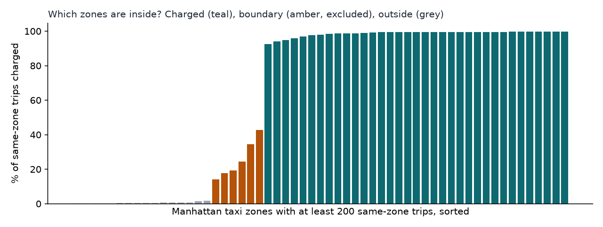
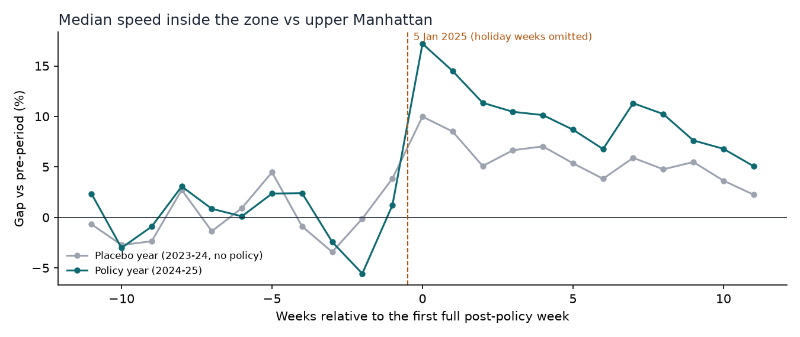
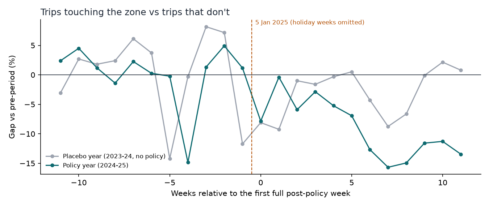

# Results — run of 2026-09-22

Every number is produced by `congestion analyze` on the twelve checksum-verified monthly files. The bootstrap uses 5,000 resamples with a fixed seed, so re-running reproduces these numbers exactly.

## 1. Which zones are charged

The policy is defined by a street boundary (60th Street), but the data is organised by 263 TLC taxi zones, and some of those zones cross the line. Instead of drawing the boundary by hand, the study reads it from the fee column. For trips that **start and end in the same zone**, the fee is charged only if that zone is inside the charged area.

| Class | Zones | Rule |
|---|---:|---|
| charged | 38 | ≥ 50% of same-zone trips charged (inside zones are at 93–100%), or, with < 200 same-zone trips, ≥ 85% of at least 1,000 pickups |
| boundary | 6 | 5–50% of same-zone trips charged: Lincoln Square East/West, Central Park, Upper East Side South, Lenox Hill East/West |
| outside | 219 | everything else |
| unknown | 2 | TLC placeholder IDs 264 "Unknown" and 265 "Outside of NYC" |

Boundary and unknown zones are left out of both groups. After the policy began (6 Jan – 30 Mar 2025):

| Group | Trips | % that paid the fee |
|---|---:|---:|
| Treated (touches a charged zone, no boundary or unknown end) | 5,919,759 | 98.82 |
| Control (neither end charged, boundary, or unknown) | 1,428,965 | 1.87 |
| Excluded | 2,506,115 | 56.92 |

The 1.87% of control trips that paid are probably trips passing through the zone without stopping in it. This contamination is small, and it would bias the volume estimate toward zero, not away from it.

## 2. Windows

| | Pre | Post |
|---|---|---|
| Policy year | 7 Oct – 22 Dec 2024 (11 weeks, Thanksgiving week excluded) | 6 Jan – 30 Mar 2025 (12 weeks) |
| Placebo year | 9 Oct – 24 Dec 2023 (11 weeks, Thanksgiving week excluded) | 8 Jan – 31 Mar 2024 (12 weeks) |

The placebo year is shifted exactly 364 days, so every date falls on the same weekday. The two weeks around New Year are excluded because they mix the holidays with the policy's first day.

**A choice made after looking:** Thanksgiving moves (28 Nov 2024 but 23 Nov 2023), so the 364-day shift misaligns it, and it showed up as a large one-week dip in the event-study chart. Each year's Thanksgiving week is excluded from its pre-period. Because I decided this after seeing the data, the estimate with those weeks kept is reported next to every result below. It changes nothing materially.

## 3. Estimates

Values are percent changes (exp of the log difference, minus 1). The intervals come from a bootstrap that resamples whole weeks.

| Specification | DiD policy year | DiD placebo year | **DDD (policy − placebo)** | DDD, Thanksgiving kept |
|---|---:|---:|---:|---:|
| Speed, all trips | +10.22 [+7.72, +12.97] | +6.15 [+4.28, +7.97] | **+3.84 [+0.84, +6.98]** | +4.05 [+1.09, +7.13] |
| Speed, excl. payment_type 0 | +10.05 [+7.56, +12.77] | +5.77 [+3.78, +7.68] | **+4.04 [+0.97, +7.22]** | +4.24 [+1.20, +7.38] |
| Trips, all records | −10.63 [−13.34, −7.72] | −4.60 [−8.28, −0.38] | **−6.32 [−11.20, −1.40]** | −6.25 [−12.11, +0.13] |
| Trips, excl. payment_type 0 | −1.40 [−4.40, +1.65] | −4.98 [−8.47, −1.14] | **+3.77 [−1.27, +8.95]** | +3.69 [−2.37, +10.28] |

**Pre-period trends** are the slope of the weekly gap before the policy, in log points per week:

| Specification | Policy year | Placebo year |
|---|---:|---:|
| Speed, all trips | −0.0024 | +0.0027 |
| Trips, all records | −0.0004 | −0.0021 |

These are all under 0.3% per week, so neither outcome was already drifting before the policy.

### Speed

Both years jump at week 0, because January traffic is lighter downtown than in upper Manhattan every year. The policy year jumps further and stays higher for the whole quarter. The +3.8% DDD is that extra distance. It holds whether or not `payment_type 0` rows are included, and whether or not Thanksgiving weeks are dropped.

### Trip volume, and why no conclusion is drawn

With all records, zone trips fell 6.3% relative to control, beyond the placebo-year change. Dropping `payment_type 0` rows turns that into a 3.8% *rise*. The reason is visible in the data:

| Month | `payment_type 0` share, control | share, treated |
|---|---:|---:|
| Oct 2024 | 13.1% | 9.6% |
| Jan 2025 | 17.3% | 13.5% |
| Mar 2025 | 34.8% | 18.0% |

These rows have ordinary medians (2–3 miles, normal speeds), so they look like real trips recorded differently. Their share nearly tripled in the control group during the same months the policy started, and grew far less in the treated group. Dropping them removes more control trips over time and makes the zone look better. Keeping them may instead mix in a record type whose own growth has nothing to do with the policy. I cannot separate those two stories with this data, so **I don't claim a volume effect**. The widening gap after week 6 in the chart lines up with the February–March surge in `payment_type 0` records in the control group.

## 4. Checks on the method

- **The DDD removes seasonality.** A test builds synthetic data with a true effect of 0.10 and a seasonal drift of 0.05 in both years. Plain DiD returns 0.15, and DDD returns exactly 0.10.
- **Interval coverage.** Over 40 synthetic datasets with a known effect, the 95% interval contained the truth 37 times (92.5%). That is slightly below nominal, as expected with 11–12 weeks per window, and it is pinned by a test.
- **Excluded weeks really are excluded.** A −1.0 spike placed only in the Thanksgiving week leaves the estimate at 0.

## Known limits

- **Yellow taxis are a small and shrinking share of NYC traffic.** Speed here is taxi door-to-door speed, including stops. It is a proxy for congestion, not a measurement of it.
- **The speed comparison assumes upper Manhattan was unaffected.** If traffic diverted north to avoid the charge, upper Manhattan got slower, and the +3.8% partly measures that diversion.
- **Composition.** If the fee changed *which* trips happen inside the zone (for example, fewer very short hops), median speed can move without any change in traffic.
- **One quarter after the start.** Longer-run effects are not measured.
- **Other January 2025 changes** that hit downtown and upper Manhattan differently would be absorbed into the estimate. The placebo year removes recurring seasonality, not one-off events.
